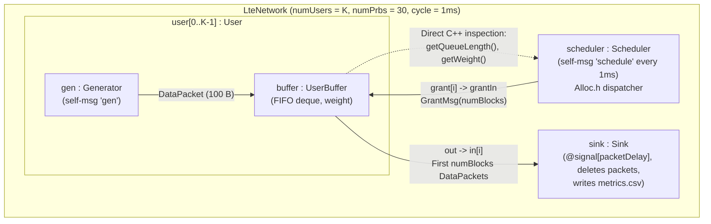

# LTE MAC Downlink Scheduler — Complete Simulation Flow & Presentation Guide

> Complete technical reference, architecture walkthrough, algorithm proofs, verified simulation analysis, live demo script, and defense Q&A for the OMNeT++ LTE MAC Downlink Scheduling project (`omnet-assignments`).

---

## 1. Executive Summary & LTE MAC Fundamentals

### 1.1 Course Objective & Problem Mapping
This project implements **Task 1 — Downlink (DL) MAC-level Scheduling in LTE** using OMNeT++ 6.5.0:
- **$K$ mobile users** (`User` compound module array `user[numUsers]`), each containing an independent traffic `Generator` and FIFO `UserBuffer` queue.
- **One centralized MAC `Scheduler`** activated once every scheduling cycle (`cycle = 1 ms` = 1 LTE TTI / subframe), reading user queue depths and service weights, running a configurable PRB allocation algorithm over $B = 30$ Physical Resource Blocks (`numPrbs = 30`), and signaling grants back to users.
- **One `Sink`** acting as the downlink destination, deleting delivered `DataPacket` messages, filtering out the initial `0.5 s` transient (`warmup-period = 0.5s`), collecting per-user, per-priority-class (`HP`, `MP`, `LP`), and system-wide delay statistics, and exporting `metrics.csv`.

### 1.2 Physical & Timing Assumptions in the Model
| Concept | LTE / Assignment Meaning | Parameter / Implementation in Project |
| :--- | :--- | :--- |
| Scheduling Cycle ($T_B$) | 1 LTE Transmission Time Interval (TTI) | `LteNetwork.cycle = 1ms` |
| Radio Channels ($B$) | Total Physical Resource Blocks (PRBs) per TTI | `LteNetwork.numPrbs = 30` |
| Transport / Radio Block | 1 PRB carries 1 fixed-size `DataPacket` per TTI | `DataPacket` (`byteLength = 100` bytes) |
| Mobile Users ($K$) | Either 2 identical users or an array of $K$ heterogeneous users | `LteTwoUsers` (`K = 2`), `LteBase` / `LteLoadSweep` (`K = 10`) |
| Channel Model (`os` / `pf`) | Instantaneous normalized user CQI / radio link quality | `uniform(0.1, 1.0)` sampled per user per TTI in `Scheduler` |
| Statistical Steady State | Warmup discarded so transient startup does not skew means | `warmup-period = 0.5s`, `sim-time-limit = 4s` |

---

## 2. OMNeT++ Architecture & Code Map

### 2.1 File Inventory
| File | Role |
| :--- | :--- |
| [LteNetwork.ned](LteNetwork.ned) | Top-level network connecting `user[numUsers]`, `scheduler`, and `sink`. |
| [User.ned](User.ned) | Compound user module wiring `gen: Generator` $\rightarrow$ `buffer: UserBuffer`. |
| [Generator.ned](Generator.ned), [Generator.h](Generator.h), [Generator.cc](Generator.cc) | Poisson-like exponential packet generator creating `100`-byte `DataPacket` messages. |
| [UserBuffer.ned](UserBuffer.ned), [UserBuffer.h](UserBuffer.h), [UserBuffer.cc](UserBuffer.cc) | Per-user FIFO `std::deque<DataPacket *>`, serves up to `numBlocks` on `GrantMsg`, records `residualQueue` scalar. |
| [Scheduler.ned](Scheduler.ned), [Scheduler.h](Scheduler.h), [Scheduler.cc](Scheduler.cc) | Periodic `1 ms` MAC controller reading queues/weights, sampling channel quality (`os`/`pf`), sending `GrantMsg`. |
| [Alloc.h](Alloc.h) | Pure C++ allocation algorithms (`fixed`, `rr`, `wrr`, `lq`, `os`, `pf`). |
| [alloc_test.cpp](alloc_test.cpp) | Standalone C++ unit test suite (14 tests) validating `Alloc.h` invariants and tie-breaking. |
| [Sink.ned](Sink.ned), [Sink.h](Sink.h), [Sink.cc](Sink.cc) | Post-warmup delay collector (`cStdDev`, `@signal[packetDelay]`), priority classifier (`HP`/`MP`/`LP`), packet deleter. |
| [MetricsCsv.h](MetricsCsv.h) | Shared CSV writer outputting `metrics.csv`. |
| [packet.msg](packet.msg) | OMNeT++ message definitions: `DataPacket` (`cPacket`) and `GrantMsg` (`cMessage`). |
| [omnetpp.ini](omnetpp.ini) | Configurations: `General`, `LteTwoUsers`, `LteBase`, `LteLoadSweep` (24 runs). |
| [makemake.sh](makemake.sh), [run.sh](run.sh) | Build script (`assignments` + `assignments_dbg`) and unified CLI (`Cmdenv`) / GUI (`Qtenv`) launcher. |
| [plot_results.py](plot_results.py) | Generates the 3 comparison PNG figures from `metrics.csv`. |

### 2.2 Module Topology Diagram

Notice an important design detail: `User` does **not** send queue-status messages upstream to `Scheduler`. Instead, `Scheduler` directly inspects each user's `UserBuffer` submodule via `getQueueLength()` and `getWeight()`, and sends downlink `GrantMsg` allocations across `scheduler.grant[i] --> user[i].grantIn`. Data packets travel strictly downstream (`Generator` $\rightarrow$ `UserBuffer` $\rightarrow$ `Sink`).



### 2.3 Key Message & Module Contracts

1. **`packet.msg`**:
   - `packet DataPacket`: inherits `cPacket`; fields `int userId`, `int weight`, `simtime_t createdAt` (`byteLength` set to `100` in `Generator`).
   - `message GrantMsg`: inherits `cMessage`; field `int numBlocks`.
2. **`User.ned`**:
   - Parameters: `userId = default(0)`, `weight = default(1)`, `volatile double interarrivalTime @unit(s) = default(exponential(1ms))`.
   - Submodules: `gen: Generator`, `buffer: UserBuffer`.
   - Connections: `gen.out --> buffer.in`, `grantIn --> buffer.grantIn`, `buffer.out --> out`.
3. **Why `UserBuffer` sets `pkt->setWeight(weight)` on transmit**:
   - `Generator` stamps `userId`, `createdAt = simTime()`, `byteLength = 100`, and a placeholder `weight = 1`.
   - When `UserBuffer` pops packets in response to a `GrantMsg`, it sets `pkt->setWeight(weight)` so `Sink` knows the user's configured priority class (`HP` if `weight >= 6`, `MP` if `weight >= 2`, `LP` if `weight < 2`) without duplicating `weight` parameters in `Generator` or `Sink`.

---

## 3. Total Event-by-Event Simulation Flow

OMNeT++ executes a **Discrete Event Simulation (DES)** driven by a Future Event Set (FES) ordered strictly by simulation timestamp (`simTime()`). Two independent periodic/stochastic event chains coexist in `LteNetwork`:
1. **Asynchronous Packet Arrivals** (per-user exponential self-message `"gen"` in `Generator`).
2. **Synchronous MAC Scheduling Ticks** (global `1 ms` self-message `"schedule"` in `Scheduler`).

```mermaid
sequenceDiagram
    autonumber
    participant GEN as "Generator (user[i].gen)"
    participant BUF as "UserBuffer (user[i].buffer)"
    participant SCH as "Scheduler"
    participant SNK as "Sink"

    Note over GEN,SCH: Initialization Phase (t = 0)
    GEN->>GEN: initialize(): scheduleAt(interarrivalTime, "gen")
    SCH->>BUF: initialize(): cache UserBuffer* pointers & reset lastServedTime = 0
    SCH->>SCH: initialize(): scheduleAt(cycle = 1ms, "schedule")

    Note over GEN,BUF: Stochastic Arrival Loop (independent per user)
    GEN->>GEN: Self-msg "gen" fires at t_arr
    GEN->>BUF: send DataPacket(userId=i, createdAt=t_arr, 100B)
    GEN->>GEN: reschedule "gen" at t_arr + exponential(...)
    BUF->>BUF: handleMessage(): push_back(pkt) into FIFO deque

    Note over SCH,SNK: Deterministic MAC Cycle (every t_k = k * 1ms)
    SCH->>SCH: Self-msg "schedule" fires at t_k
    SCH->>BUF: Read queue[i] = getQueueLength(), weight[i] = getWeight()
    SCH->>SCH: Compute waitCycles[i]; sample quality[i] = uniform(0.1, 1.0) if os/pf
    SCH->>SCH: Run Alloc.h -> grant[0..K-1] (sum <= 30)
    loop For every user i with grant[i] > 0
        SCH->>SCH: lastServedTime[i] = t_k
        SCH->>BUF: send GrantMsg(numBlocks = grant[i]) on grant[i]
        BUF->>BUF: delete GrantMsg; pop min(numBlocks, queue.size()) packets
        BUF->>SNK: send DataPacket (stamped with weight[i]) to sink.in[i]
        SNK->>SNK: delay = simTime() - createdAt; if t_k >= 0.5s record metrics; delete pkt
    end
    SCH->>SCH: reschedule "schedule" at t_k + 1ms

    Note over BUF,SNK: End of Simulation (t = 4s)
    BUF->>BUF: finish(): recordScalar("residualQueue", queue.size())
    SNK->>SNK: finish(): record scalars & write metrics.csv
```

### 3.1 Step-by-Step Walkthrough of One Complete Cycle

1. **`initialize()` (`t = 0`)**:
   - Each `Generator` draws its first `par("interarrivalTime")` (using RNG 0 in `LteBase`) and schedules `"gen"`.
   - `Scheduler::initialize()` resolves `getParentModule()->getSubmodule("user", i)->getSubmodule("buffer")` via `check_and_cast<UserBuffer *>` for $i = 0 \dots K-1$, initializes `lastServedTime` to `0`, and schedules `cycleTimer` (`"schedule"`) at `1 ms`.
2. **Arrival Phase (`t_arr < t_k`)**:
   - Whenever `"gen"` fires, `Generator::handleMessage()` creates `new DataPacket("data")`, sets `userId`, `weight = 1`, `createdAt = simTime()`, `byteLength = 100`, sends it on `"out"`, and immediately reschedules `"gen"`.
   - `UserBuffer::handleMessage()` receives `DataPacket` on `"in"` and appends it to its FIFO `std::deque<DataPacket *> queue`. Notice **no delay occurs at arrival**; packets simply accumulate until the next `Scheduler` tick.
3. **Scheduling Tick (`t_k = k * 1 ms`)**:
   - `"schedule"` fires in `Scheduler::scheduleCycle()`.
   - For every user $i$:
     - `queue[i] = buffers[i]->getQueueLength()`
     - `weight[i] = buffers[i]->getWeight()`
     - `waitCycles[i] = std::max(1.0, (simTime() - lastServedTime[i]).dbl() / cycle.dbl())`
   - If `algorithm == "os"` or `"pf"`, `Scheduler` draws `quality[i] = uniform(0.1, 1.0)` for each user $i$.
   - `Alloc.h` computes integer grants `grant[i]` satisfying $0 \le \text{grant}[i] \le \text{queue}[i]$ and $\sum_i \text{grant}[i] \le B$.
   - For each user with `grant[i] > 0`, `Scheduler` sets `lastServedTime[i] = simTime()` and sends a `GrantMsg` with `numBlocks = grant[i]` via `"grant", i`. Zero-grant users receive no message.
4. **Transmission & Sink Processing (at `t_k`, zero propagation delay)**:
   - Because channels in `LteNetwork.ned` are zero-delay ideal links (`-->`), `GrantMsg` arrives at `UserBuffer` at the same simulation timestamp `t_k`.
   - `UserBuffer` deletes `GrantMsg`, pops up to `grant->getNumBlocks()` packets from the **front** of its FIFO `queue` (oldest packets first), stamps `pkt->setWeight(weight)`, and sends each on `"out"`.
   - `Sink::handleMessage()` computes `delay = simTime() - pkt->getCreatedAt()`. Because packets depart at `t_k`, every packet suffers a **minimum queuing + framing latency** equal to the time from its stochastic arrival `createdAt` until its assigned TTI `t_k` (mean $\approx T_B / 2 = 0.5\text{ ms}$ under unloaded conditions).
   - If `simTime() >= warmupPeriod` (`0.5 s`), `Sink` updates `userDelay[id]` and `systemDelay` (`cStdDev` objects), emits `delaySignal` (`packetDelay`), and **always deletes `pkt`** (`delete pkt`) so memory remains constant.
5. **Termination (`t = 4 s`)**:
   - `UserBuffer::finish()` records `residualQueue` scalar (verifying queue stability: max residual across all 24 `LteLoadSweep` runs is `8` packets).
   - `Sink::finish()` records `systemMeanDelay`, `systemPackets`, etc., and writes/appends rows to `metrics.csv` via `MetricsCsv.h`.

---

## 4. Scheduling Algorithms in `Alloc.h` (Deep Dive & Worked Example)

All six algorithms take the current snapshot (`queue`, `weight`, `waitCycles`, `quality`, `numPrbs`, `cursor`) and produce `grant[0..K-1]`. Five of the six (`rr`, `wrr`, `lq`, `os`, `pf`) are **work-conserving** (they never leave PRBs idle while any queue still has packets, up to per-user caps where applicable), whereas `fixed` is **non-work-conserving**.

### 4.1 Summary of All 6 Algorithms

| Name (`omnetpp.ini`) | Function in `Alloc.h` | Work-Conserving? | Priority Score / Ordering Rule | Max Per Pass / User | Starvation Protection |
| :--- | :--- | :--- | :--- | :--- | :--- |
| `"fixed"` | `allocateFixed` | **No** | Static share `base + (i < rem ? 1 : 0)`, `base = B / K` | `min(queue[i], share)` | Static guarantee (`3` PRBs when $B=30, K=10$) |
| `"rr"` | `allocateRR` via `allocateRankedPasses` | **Yes** | `score[i] = waitCycles[i]` desc; ties by `(i - cursor + n) % n` | `1` PRB per pass (multi-pass until $B$ exhausted or queues empty) | Explicit (`waitCycles` puts longest-waiting users first + cyclic cursor) |
| `"wrr"` | `allocateWRR` via `allocateRankedPasses` | **Yes** | `score[i] = waitCycles[i] * weight[i]` desc | `weight[i]` PRBs per pass (multi-pass) | `waitCycles` grows linearly if skipped |
| `"lq"` | `allocateLQ` | **Yes** | Greedy 1 PRB at a time maximizing `(queue[i] - grant[i]) * weight[i]`; tie `i < best` | Unbounded up to `queue[i]` | Queue backlog grows when unserved |
| `"os"` | `allocateOS` via `allocateByScoreAuction` | **Yes** (up to `maxPrbsPerUser`) | `score[i] = quality[i]` (`uniform(0.1, 1.0)`) desc | `maxPrbsPerUser` (`10` in `LteBase`) | Statistical (channel draws vary randomly per TTI) |
| `"pf"` | `allocatePF` via `allocateByScoreAuction` | **Yes** (up to `maxPrbsPerUser`) | `score[i] = waitCycles[i] * weight[i] * quality[i]` desc (`w >= 1`, `wt >= 1`, `rq >= 0`) | `maxPrbsPerUser` (`10` in `LteBase`) | Strong (`waitCycles` boosts any delayed user's score) |

> **Architectural reuse in `Alloc.h`**:
> - Both `rr` and `wrr` share `allocateRankedPasses()`, which builds active candidates (`queue[i] > 0`), sorts once by `score` descending (with cyclic cursor tie-breaker), and loops passes granting `min(left, min(capPerPass[i], queue[i] - grant[i]))` until `left == 0` or no user has remaining packets.
> - Both `os` and `pf` share `allocateByScoreAuction()`, differing only in the auction bid `score[i]`.

### 4.2 Concrete Worked Example ($B = 30$, $K = 10$)

Assume `LteBase` weights:
- `weight = [8, 6, 2, 2, 2, 2, 2, 1, 1, 1]` (User 0 = `HP`, User 1 = `HP`, Users 2..6 = `MP`, Users 7..9 = `LP`)
- Suppose at TTI $t_k$, `waitCycles = 1.0` for all users, `cursor = 0`, and instantaneous queue lengths are:
  - `queue = [12, 8, 4, 3, 2, 2, 2, 1, 1, 0]` (Total queued packets = **35** $> B = 30$)

Look at how each deterministic scheduler distributes the **30 PRBs**:

| Algorithm | User 0 (`q=12, w=8`) | User 1 (`q=8, w=6`) | User 2 (`q=4, w=2`) | User 3 (`q=3, w=2`) | Users 4..6 (`q=2, w=2` each) | Users 7..8 (`q=1, w=1` each) | User 9 (`q=0, w=1`) | PRBs Used / Wasted | Remaining Backlog |
| :--- | :---: | :---: | :---: | :---: | :---: | :---: | :---: | :---: | :--- |
| **`fixed`** (`base=3`) | 3 | 3 | 3 | 3 | 2, 2, 2 | 1, 1 | 0 | **20 / 10 wasted** | `15` packets left (`u0:9, u1:5, u2:1`) |
| **`rr`** (8 passes of 1) | 8 | 7 | 4 | 3 | 2, 2, 2 | 1, 1 | 0 | **30 / 0 wasted** | `5` packets left (`u0:4, u1:1`) |
| **`wrr`** (Pass 1 + Pass 2) | 12 | 6 | 2 | 2 | 2, 2, 2 | 1, 1 | 0 | **30 / 0 wasted** | `5` packets left (`u1:2, u2:2, u3:1`) |
| **`lq`** (`rem_q * weight`) | 12 | 8 | 4 | 3 | 1, 1, 1 | 0, 0 | 0 | **30 / 0 wasted** | `5` packets left (`u4..u6:1, u7..u8:1`) |

**Key Takeaways from this Numerical Trace:**
1. **`fixed` wastes 10 out of 30 PRBs** even while 15 packets are waiting in Users 0..2, because unused slots from light users (`u4..u9`) are never reallocated.
2. **`rr`, `wrr`, and `lq` all transmit 30 packets and leave 5 packets in the system** — **identical total backlog**, visually illustrating why their system-wide mean delays are virtually identical!
3. **Who carries those 5 delayed packets flips completely**:
   - `rr` treats Users 0..1 equally up to `q`, delaying `HP` Users 0 and 1.
   - `wrr` drains `u0` completely (`8 + 4 = 12`) in Pass 2 and shields `HP` traffic (`u1:2, u2:2, u3:1`).
   - `lq` aggressively drains the heaviest queue $\times$ weight backlogs (`u0..u3` down to `0`) and pushes the 5 remaining slots entirely onto lower-weight users (`u4..u8`).
4. **`os` vs `pf`**: On the same queues, `os` ignores `weight` and `waitCycles`, sorting solely by `quality[i]` (up to `maxPrbsPerUser = 10`), whereas `pf` multiplies `quality[i]` by `waitCycles[i] * weight[i]` so `HP` users win PRB auctions systematically more often than `LP` users while still preferring higher-CQI cycles.

---

## 5. Offered Load Derivation & `omnetpp.ini` Configurations

### 5.1 Mathematical Formula for `interarrivalTime`
In `LteNetwork`, 1 packet occupies 1 PRB for 1 cycle ($T_B = 1\text{ ms}$). Therefore, total cell service capacity is:
$$C = \frac{B}{T_B} = \frac{30\text{ PRBs}}{0.001\text{ s}} = 30,000\text{ packets/s}$$

With $K$ identically loaded users (`numUsers`) at target offered load $\rho = \text{offeredLoad} \in (0, 1)$, each user's mean packet arrival rate is $\lambda_i = \frac{\rho \cdot B}{K \cdot T_B}$, giving mean exponential interarrival time:
$$E[\text{interarrivalTime}] = \frac{1}{\lambda_i} = \frac{K \cdot T_B}{\rho \cdot B}$$

Checking the exact values configured in [omnetpp.ini](omnetpp.ini):
- **`LteTwoUsers`** ($K = 2, B = 30, T_B = 1\text{ ms}, \rho = 0.5$):
  $$\frac{2 \cdot 1\text{ ms}}{0.5 \cdot 30} = \frac{2}{15}\text{ ms} = 0.133333\text{ ms}$$
- **`LteBase` & `LteLoadSweep`** ($K = 10, B = 30, T_B = 1\text{ ms}$):
  - $\rho = 0.3 \implies \frac{10}{0.3 \cdot 30} = 1.111111\text{ ms}$
  - $\rho = 0.5 \implies \frac{10}{0.5 \cdot 30} = 0.666667\text{ ms}$ (`LteBase`)
  - $\rho = 0.7 \implies \frac{10}{0.7 \cdot 30} = 0.476190\text{ ms}$
  - $\rho = 0.9 \implies \frac{10}{0.9 \cdot 30} = 0.370370\text{ ms}$

### 5.2 Simulation Configurations (`omnetpp.ini`)
- **`[General]`**: `network = LteNetwork`, `sim-time-limit = 4s`, `warmup-period = 0.5s`, `seed-set = 1`, `num-rngs = 4`, `result-dir = results`.
- **`[Config LteTwoUsers]`**: $K = 2$, `"rr"`, `offeredLoad = 0.5`, equal weights (`1`). Satisfies the initial two-identical-users requirement.
- **`[Config LteBase]`**: $K = 10$, `"wrr"`, `offeredLoad = 0.5`, `maxPrbsPerUser = 10`, heterogeneous weights:
  - `user[0]`: `weight = 8` (`HP`)
  - `user[1]`: `weight = 6` (`HP`)
  - `user[2..6]`: `weight = 2` (`MP`, 5 users)
  - `user[7..9]`: `weight = 1` (`LP`, 3 users)
- **`[Config LteLoadSweep]`** (`extends LteBase`): full factorial sweep across `${alg="fixed","rr","wrr","lq","os","pf"}` $\times$ `${load=0.3,0.5,0.7,0.9}` = **24 simulation runs**.

---

## 6. Verified Results Analysis & Plot Explanations

All numbers below come directly from the verified `LteTwoUsers`, `LteBase`, and `LteLoadSweep` (24/24 runs) outputs and [metrics.csv](metrics.csv). Across all 24 sweep runs, maximum end-of-run `residualQueue` was **`8` packets** (confirming stability with no unstable queue blow-up).

### 6.1 System Mean Delay vs. Offered Load (`results/lte_delay_vs_load.png`)

| Algorithm | Load 30% [ms] | Load 50% [ms] | Load 70% [ms] | Load 90% [ms] |
| :--- | :---: | :---: | :---: | :---: |
| **`fixed`** | `0.519` | `0.589` | `0.781` | **`1.842`** |
| **`rr`** | `0.498` | `0.498` | `0.503` | `0.584` |
| **`wrr`** | `0.498` | `0.498` | `0.503` | `0.584` |
| **`lq`** | `0.498` | `0.498` | `0.503` | `0.584` |
| **`os`** | `0.501` | `0.500` | `0.503` | `0.582` |
| **`pf`** | `0.501` | `0.500` | `0.503` | `0.582` |

How to explain this graph on stage:
1. **Why every curve starts at $\approx 0.50\text{ ms}$ (30%–50% load)**: Poisson arrivals occur uniformly within each `1 ms` scheduling interval. When all queues drain every TTI, the average time a packet waits from `createdAt` until the next `1 ms` `Scheduler` tick is $T_B / 2 = 0.5\text{ ms}$. (For `LteBase`, `systemMeanDelay = 0.00049787 s` across `52,618` packets with `0` residual packets.)
2. **Why `fixed` explodes to `1.842 ms` (>3$\times$ higher) at 90% load**: Fixed TDM allocates at most `B / K = 3` PRBs per user per TTI. Whenever a user receives $> 3$ arrivals in 1 ms (a frequent Poisson burst at 70%–90% load), excess packets wait extra TTIs *even though other users have empty queues and spare PRBs go unused*.
3. **Why all 5 work-conserving curves nearly overlap ($\approx 0.582 - 0.584\text{ ms}$ at 90% load)**: **Kleinrock's Conservation Law**. Because every packet has identical size (1 PRB) and all 5 schedulers transmit $\min(30, \sum q_i)$ packets per TTI, the *total* backlog remaining after each TTI is invariant to which user was served (unless `maxPrbsPerUser = 10` binds momentarily under extreme single-user bursts in `os`/`pf`). Thus total system mean delay cannot change significantly among work-conserving algorithms — **differences appear in per-class delay differentiation and radio-link awareness**.

### 6.2 Per-Class Delay Breakdown (`results/lte_delay_by_class_70.png` & `results/lte_delay_by_class_90.png`)

**At 70% Offered Load [ms]:**
| Algorithm | `HP` (`weight >= 6`) | `MP` (`weight 2..5`) | `LP` (`weight < 2`) | Behavior |
| :--- | :---: | :---: | :---: | :--- |
| **`fixed`** | `0.755` | `0.789` | `0.784` | High delay everywhere (PRBs wasted) |
| **`rr`** | `0.500` | `0.504` | `0.502` | Flat (~`0.50 ms`), ignores weights |
| **`wrr`** | `0.498` | `0.502` | `0.507` | Slight separation begins as occasional congestion occurs |
| **`lq`** | `0.498` | `0.502` | `0.508` | Same as `wrr`, slightly prioritizes `HP` |
| **`os`** | `0.503` | `0.503` | `0.502` | Flat, ignores weights |
| **`pf`** | `0.500` | `0.502` | `0.506` | Slight weight ordering + CQI awareness |

**At 90% Offered Load [ms] (Congestion Differentiates the Algorithms!):**
| Algorithm | `HP` (`weight >= 6`) | `MP` (`weight 2..5`) | `LP` (`weight < 2`) | Behavior |
| :--- | :---: | :---: | :---: | :--- |
| **`fixed`** | `1.807` | `1.815` | `1.910` | Severely degraded across all classes |
| **`rr`** | `0.579` | `0.585` | `0.584` | Blind to QoS weights (`HP ≈ MP ≈ LP`) |
| **`os`** | `0.583` | `0.580` | `0.583` | Blind to QoS weights (`HP ≈ MP ≈ LP`) |
| **`wrr`** | **`0.502`** | `0.520` | `0.744` | Protects `HP` near the `0.50 ms` floor; defers `LP` |
| **`lq`** | **`0.502`** | `0.536` | `0.717` | Protects `HP` (`0.502 ms`); trades minor `MP` delay for lower `LP` peak |
| **`pf`** | **`0.500`** | `0.558` | **`0.674`** | **Best overall balance**: preserves `HP = 0.500 ms` while keeping `LP` lowest among weighted schemes and exploiting CQI |

How to summarize the two bar charts cleanly:
- **At 70% load**, total arrival rate is still well below capacity (`30` PRBs/ms), so almost every queue drains in 1 TTI ($\approx 0.50\text{ ms}$) except `fixed` (`~0.76 - 0.79 ms`).
- **At 90% load**, queues regularly exceed `30` packets/ms, forcing scheduling trade-offs:
  - Unweighted work-conserving schemes (**`rr`**, **`os`**) spread congestion evenly (`~0.58 ms` for everyone), giving `HP` no protection.
  - Weighted work-conserving schemes (**`wrr`**, **`lq`**, **`pf`**) shield `HP` users right at the theoretical minimum **`0.500 - 0.502 ms`** by borrowing delay budget from `LP` (`0.674 - 0.744 ms`), keeping the system-wide mean unchanged at `~0.583 ms`.

---

## 7. Presentation Readiness: 5-Minute Demo Script & Defense Q&A

### 7.1 5-Minute Live Demo Walkthrough
1. **Unit Tests (30s)** — Prove `Alloc.h` math independently of OMNeT++:
   ```bash
   c++ -std=c++11 -Wall -Wextra -o alloc_test alloc_test.cpp && ./alloc_test
   # Expected output: all passed (14 unit tests)
   ```
2. **OMNeT++ GUI (`Qtenv`) Visual Inspection (90s)**:
   ```bash
   ./run.sh -c LteBase
   ```
   - Point out `LteNetwork` canvas (`bgb=920,460`): 10 `user[i]` compound modules, `scheduler`, and `sink`.
   - Step a few events or run until `t = 1ms` to show `"gen"` self-messages queueing `DataPacket`s inside `UserBuffer`, then `"schedule"` firing in `Scheduler` and dispatching `GrantMsg` back to users.
3. **Full Parameter Sweep & CSV/Plots (90s)**:
   ```bash
   ./run.sh -u Cmdenv -c LteLoadSweep omnetpp.ini
   python3 plot_results.py
   ```
   - Show all 24 runs completing cleanly (`LteLoadSweep-0` .. `LteLoadSweep-23`).
   - Open [results/lte_delay_vs_load.png](results/lte_delay_vs_load.png), [results/lte_delay_by_class_70.png](results/lte_delay_by_class_70.png), and [results/lte_delay_by_class_90.png](results/lte_delay_by_class_90.png) and walk through `fixed` vs work-conserving and 70% vs 90% QoS separation.
4. **Code Highlight (60s)** — Open [Scheduler.cc](Scheduler.cc) and [Alloc.h](Alloc.h) side by side to show the single `scheduleCycle()` loop dispatching cleanly into `allocateFixed`, `allocateRR`, `allocateWRR`, `allocateLQ`, `allocateOS`, and `allocatePF`.

### 7.2 Top 10 Professor / Defense Questions & Prepared Answers

1. **Q: Why does `Scheduler` read `UserBuffer` via C++ pointers instead of users sending queue-report packets every TTI?**
   **A:** Per `LTE_scheduling.html`, the scheduler reads the lengths of users' queues directly and informs each user via `grantIn` how many radio blocks to send. Caching `UserBuffer *` pointers in `Scheduler::initialize()` avoids polluting the event queue and animations with 10 extra control messages per millisecond while keeping the grant downlink explicit (`GrantMsg`).

2. **Q: Why is the minimum mean delay ~`0.50 ms` even at low load (30%)?**
   **A:** Packets arrive stochastically (`exponential`) across the `1 ms` interval between `Scheduler` ticks. Since transmissions happen only once every `cycle = 1 ms`, a packet arriving uniformly within $[t_k - 1\text{ ms}, t_k)$ waits on average $T_B / 2 = 0.5\text{ ms}$ for the next scheduling tick.

3. **Q: Why do `rr`, `wrr`, `lq`, `os`, and `pf` have virtually identical *system* mean delay (~`0.583 ms` at 90% load)?**
   **A:** By **Kleinrock's Conservation Law**: all packets have equal size (`100` B = `1` PRB) and equal service time (`1` PRB per packet per TTI), and every work-conserving algorithm transmits $\min(30, \sum_i q_i)$ packets per TTI. Changing *which* user gets the PRB redistributes waiting time between classes (`HP` vs `LP`) without changing the total packet count waiting in the cell.

4. **Q: Why does `fixed` behave so badly at high load (`1.842 ms` vs `0.584 ms`)?**
   **A:** `allocateFixed` slices the 30 PRBs rigidly as `30 / 10 = 3` per user per TTI without redistribution. At 90% load ($\lambda_i = 2.7\text{ pkt/ms}$), Poisson arrivals frequently burst to 4–7 packets for some users while others get 0–1; `fixed` wastes empty users' PRBs while bursting queues overflow into multiple extra TTIs.

5. **Q: How do you prevent starvation in `wrr`, `lq`, and `pf`?**
   **A:**
   - In `wrr` and `rr`, `waitCycles[i] = max(1, (simTime - lastServedTime[i]) / cycle)` scales priority upward for any unserved user, paired with a rotating `cursor`.
   - In `lq`, any unserved user accumulates `queue[i]`, strictly increasing `(queue[i] - grant[i]) * weight[i]`.
   - In `pf`, `score[i] = waitCycles[i] * weight[i] * quality[i]` multiplies `waitCycles` directly so skipped users win future auctions even with modest channel quality.

6. **Q: How is `offeredLoad` ($\rho$) linked to the interarrival times in `omnetpp.ini`?**
   **A:** Cell capacity is $B / T_B = 30 / 1\text{ ms} = 30\text{ pkt/ms}$. For $K = 10$ users, total arrival rate is $30\rho\text{ pkt/ms}$, so per-user rate is $3\rho\text{ pkt/ms}$, and mean interarrival time is $1 / (3\rho)\text{ ms}$ (`1.111111ms`, `0.666667ms`, `0.476190ms`, `0.370370ms` for $\rho = 0.3, 0.5, 0.7, 0.9$).

7. **Q: Why did you set `warmup-period = 0.5s` out of `sim-time-limit = 4s`?**
   **A:** All queues start empty at $t = 0$. Measuring during the empty transient artificially biases mean delay downward; `Sink::handleMessage()` only records metrics when `simTime() >= warmupPeriod` (`0.5 s` = 500 scheduling cycles), leaving `3.5 s` (3,500 TTIs, $> 50,000$ packets in `LteBase`) of steady-state data.

8. **Q: What happens at the end of simulation if packets remain inside `UserBuffer`?**
   **A:** `UserBuffer::finish()` records `residualQueue` so we verify no queue blew up (max residual across all 24 sweep runs was `8` packets), and its destructor cleanly frees remaining queued `DataPacket *` pointers.

9. **Q: What is the difference between `os` (Opportunistic / Max-CQI) and `pf` (Proportional Fair)?**
   **A:** Both use `allocateByScoreAuction` with per-user cap `maxPrbsPerUser = 10`, where each user draws an instantaneous radio quality `uniform(0.1, 1.0)` per TTI. `os` bids strictly by `quality[i]`, maximizing raw channel picks while ignoring QoS weights and waiting time. `pf` bids by `waitCycles[i] * weight[i] * quality[i]`, balancing channel quality, service weights (`HP > MP > LP`), and fairness over time.

10. **Q: How was correctness verified beyond just looking at curves?**
    **A:** Two independent verification layers:
    - **14 standalone C++ unit tests** in [alloc_test.cpp](alloc_test.cpp) testing work-conservation, queue/cap bounds, fixed waste, WRR/RR tie-breaking and cursor advance, LQ starvation clearing, and OS/PF auction scoring.
    - **End-to-end simulation invariants**: all 24 runs of `LteLoadSweep` exit 0 with bounded `residualQueue <= 8`, `LteBase` shows `0` residual packets and `0.4979 ms` mean delay across `52,618` packets, and `fixed` vs work-conserving vs priority-class ordering match queuing theory predictions.
